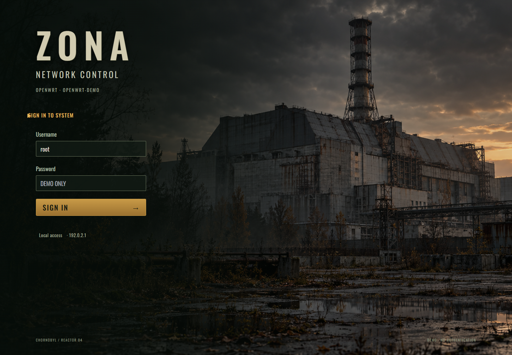

# ЗОНА · ZONA

**Атмосферная тема LuCI для OpenWrt: старый саркофаг ЧАЭС, оливковые панели и янтарные акценты.**

[English](README.en.md) · [Безопасность](SECURITY.md) · [Лицензия](LICENSE)

  

## Что внутри

- Собственный экран входа с фоном саркофага; штатная авторизация LuCI.
- Оливково-угольная палитра, янтарные элементы управления, удобные формы и боковое меню.
- Русский и английский интерфейс по языку LuCI; мобильное меню и режим уменьшенной анимации.
- Живые показатели нагрузки, памяти, времени работы; температура при доступном датчике и RPC-правах.
- Независимость от установленного пакета Argon; исходные производные стили и меню включены с указанием авторов.
- Совместимость оформления с [Observatory](https://github.com/vivolabboo-cyber/luci-app-observatory).

## Совместимость

Проверялась исходная версия на Raspberry Pi 4 / OpenWrt 25.12.6 / LuCI с ucode-шаблонами. Старые Lua-only LuCI не поддерживаются. Публичная двуязычная версия проверена локально; независимый аудит и проверка на всех прошивках не проводились. Установка на существующий роутер в рамках подготовки публикации не выполнялась.

## Установка

1. Скачайте исходники или архив релиза и проверьте SHA256SUMS.
2. Скопируйте каталог на роутер. Не выполняйте непроверенные удалённые скрипты через `curl | sh`.
3. Сохраните резервную копию OpenWrt обычным способом и убедитесь, что доступен SSH и запасная тема Bootstrap.
4. На роутере выполните `sh install.sh --activate`. Скрипт также сохранит копии заменяемых файлов и конфигурации LuCI в закрытый каталог `/root/zona-backup-*`.
5. Обновите браузер Ctrl+F5. Язык: **Система → Система → Язык и стиль**, русский или английский. Для стандартных страниц на русском требуется пакет `luci-i18n-base-ru`.

Без `--activate` тема лишь регистрируется для ручного выбора. Пароли, сеть, DNS, VPN и службы не перенастраиваются. Для удаления: `sh uninstall.sh`; активная тема переключается на уже установленный Bootstrap. Резервные копии не удаляются.

## Сборка

`python3 tools/check.py` проверяет исходники, `python3 tools/package.py` создаёт архив в `dist/` с SHA256SUMS. Для пакета IPK/APK используйте Makefile внутри подходящего OpenWrt SDK. Криптографические подписи релизов пока не предоставляются.

## Приватность и происхождение

Репозиторий содержит только исходники, лицензии, AI-фон и демонстрационные изображения. Нет паролей, SSH-ключей, личных конфигураций или реальных устройств. Все цифры на скриншотах вымышлены. Тема не отправляет телеметрию и не подключает сторонние runtime-скрипты. Бейджи GitHub в README загружаются только при просмотре документации.

CSS/меню основаны на Argon 3.1.1 (Apache-2.0). Непроверенные шрифты исходной темы исключены; Oswald распространяется по SIL OFL. Фон создан ImageGen и очищен от метаданных. Неофициальное оформление в духе постапокалиптических игровых меню; официальные игровые ресурсы не используются.
